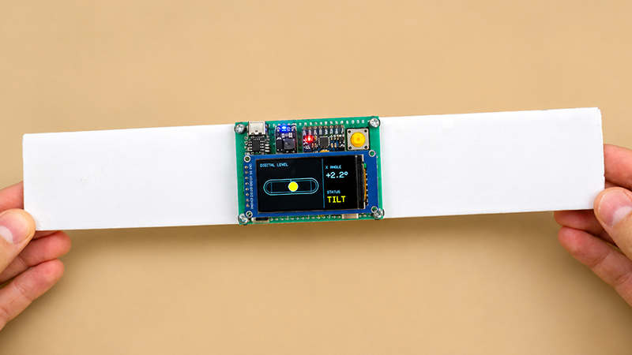
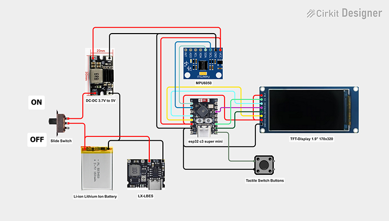

# DIY Digital Spirit Level with ESP32-C3

A DIY digital spirit level built around an **ESP32-C3 SuperMini**, an **MPU-6050** motion sensor and a **1.9-inch ST7789 IPS display**.

The device measures inclination and visualizes it as a moving bubble. It supports a traditional single-axis level and a dual-axis level, with independent zero calibration for each mode.

<p align="center">
  
</p>

## Features

- **Single-axis mode** — horizontal spirit-level style bubble with X-axis angle readout.
- **Dual-axis mode** — circular bubble display with X and Y angle readouts.
- **Independent zero calibration**:
  - Hold the button for 3 seconds in Single-axis mode to calibrate its X zero.
  - Hold the button for 3 seconds in Dual-axis mode to calibrate both X and Y zeros.
  - Calibration values for the two modes are stored separately in ESP32-C3 non-volatile storage.
- **On-screen feedback** — `CALIBRATING...` and `ZERO SET!` messages.
- **Reduced display flicker** — the interface is drawn to a framebuffer before being sent to the TFT.
- **Filtered measurements** — light smoothing helps reduce sensor jitter.

## Hardware

| Component | Description |
|---|---|
| Single-side prototype PCB | 50 × 70 mm |
| ESP32-C3 SuperMini | Main controller |
| 1.9-inch IPS LCD | ST7789, 170 × 320 |
| MPU-6050 | Accelerometer / gyroscope module |
| CKCS BS01 DC-DC converter | 3.7 V to 5 V boost converter |
| LX-LBES USB-C charging board | Li-ion charging module |
| Li-ion battery | 500 mAh |
| Pin header connectors | Board interconnections |
| Micro tactile push button | Mode selection / zero calibration |
| Miniature slide switch | Power on/off |

## Wiring

The wiring illustration below shows the overall power and signal connections used in the build.
🔹 Wiring Diagram (Cirkit Designer):
https://app.cirkitdesigner.com/project/e3083c5d-43cd-47ec-96ea-0514f1b6350c

<p align="center">
  
</p>

### Complete ESP32-C3 pinout

The following tables show every connection between the ESP32-C3 SuperMini and the display, MPU-6050 sensor and push button.

#### 1. ST7789 TFT display (1.9-inch, 170 × 320)

| Display pin label | Function | ESP32-C3 connection |
|---|---|---|
| GND | Ground | GND |
| VCC | Power | 3.3V |
| SCL | SPI clock (SCK) | GPIO 4 |
| SDA | SPI data (MOSI) | GPIO 6 |
| RES | Display reset | GPIO 10 |
| DC | Data / command | GPIO 3 |
| CS | Chip select | GPIO 7 |
| BLK | Backlight | 3.3V |

**Display interface:** SPI. The display's `SCL` pin is the SPI clock, and its `SDA` pin is MOSI. MISO is not used by this display connection.

#### 2. MPU-6050 sensor (GY-521 module)

| MPU-6050 pin | Function | ESP32-C3 connection |
|---|---|---|
| VCC | Power | 3.3V |
| GND | Ground | GND |
| SDA | I²C data | GPIO 0 |
| SCL | I²C clock | GPIO 1 |
| AD0 | I²C address select | Not connected |
| INT | Interrupt output | Not connected |
| XDA | Auxiliary I²C data | Not connected |
| XCL | Auxiliary I²C clock | Not connected |

**Sensor interface:** I²C, using address `0x68`.

#### 3. Tactile push button

| Button connection | ESP32-C3 connection |
|---|---|
| One terminal | GPIO 5 |
| Opposite terminal | GND |

The firmware configures GPIO 5 as `INPUT_PULLUP`. No external pull-up resistor is needed. Use a normally-open momentary push button.

#### ESP32-C3 GPIO summary

| ESP32-C3 pin | Connected device | Signal |
|---|---|---|
| GPIO 0 | MPU-6050 | SDA |
| GPIO 1 | MPU-6050 | SCL |
| GPIO 3 | ST7789 | DC |
| GPIO 4 | ST7789 | SPI SCLK |
| GPIO 5 | Push button | Button input |
| GPIO 6 | ST7789 | SPI MOSI |
| GPIO 7 | ST7789 | CS |
| GPIO 10 | ST7789 | RES / RST |
| 3.3V | Display and MPU-6050 | Power |
| GND | Display, MPU-6050 and button | Common ground |

**Important:** connect all grounds together. Power the display and MPU-6050 from the 3.3 V rail as shown. Check the exact pin labels on your modules before wiring; do not assume the physical pin order is identical between different ESP32-C3 SuperMini board revisions.

## How to use

1. Power on the device.
2. A short press of the button switches between Single-axis and Dual-axis modes.
3. Place the level on a reference surface.
4. Hold the button for approximately 3 seconds to set the zero for the currently active mode:
   - **Single-axis:** stores the X-axis zero for Single-axis mode only.
   - **Dual-axis:** stores X and Y zeros for Dual-axis mode only.
5. The calibration is saved in ESP32-C3 non-volatile storage and remains available after restart.

For the most accurate result, keep the device still on a known level reference surface while calibrating.

## Firmware

The Arduino sketch is located here:

[`firmware/ESP32_C3_Digital_Level/ESP32_C3_Digital_Level.ino`](firmware/ESP32_C3_Digital_Level/ESP32_C3_Digital_Level.ino)

### Arduino libraries

Install these libraries using Arduino IDE Library Manager:

- **Adafruit GFX Library**
- **Adafruit ST7735 and ST7789 Library**
- **Adafruit MPU6050**
- **Adafruit Unified Sensor**

The sketch also uses `Wire`, `SPI` and `Preferences`, which are provided by the ESP32 Arduino core.

### Upload

1. Install ESP32 board support in Arduino IDE.
2. Select the ESP32-C3 board that matches your module (for example, **ESP32C3 Dev Module**).
3. Select the correct serial port.
4. Install the libraries listed above.
5. Open `ESP32_C3_Digital_Level.ino` and upload it.

## Project structure

```text
.
├── README.md
├── images/
│   ├── digital-spirit-level.jpg
│   └── wiring-diagram.jpg
└── firmware/
    └── ESP32_C3_Digital_Level/
        └── ESP32_C3_Digital_Level.ino
```

## Notes

- The display is initialized as a 170 × 320 ST7789 panel and rotated for the landscape user interface.
- The MPU-6050 is accessed at I²C address `0x68`.
- The sketch currently uses the sensor's accelerometer-derived tilt angles.
- Zero calibration adjusts the displayed reference angle; it is not a substitute for mechanically aligning the sensor or verifying the reference surface.

## License

No license has been selected for this project yet. Add a `LICENSE` file before publishing if you want to specify how others may use, modify or redistribute the code and design.
